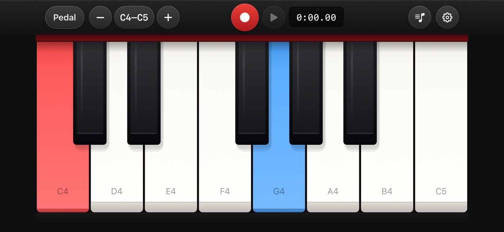
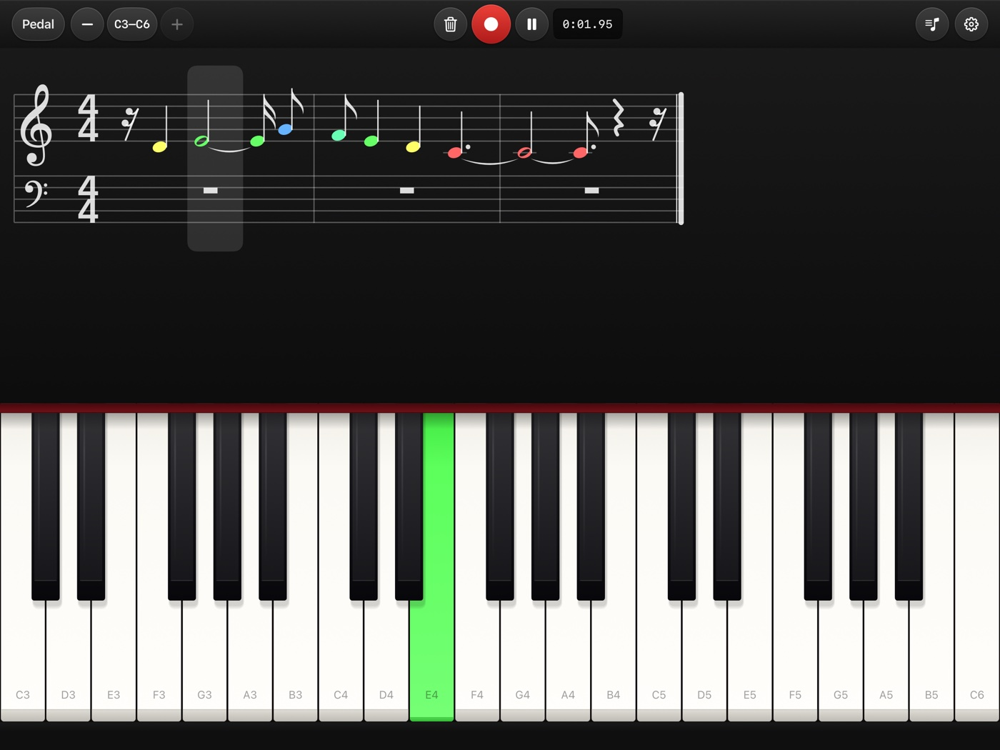
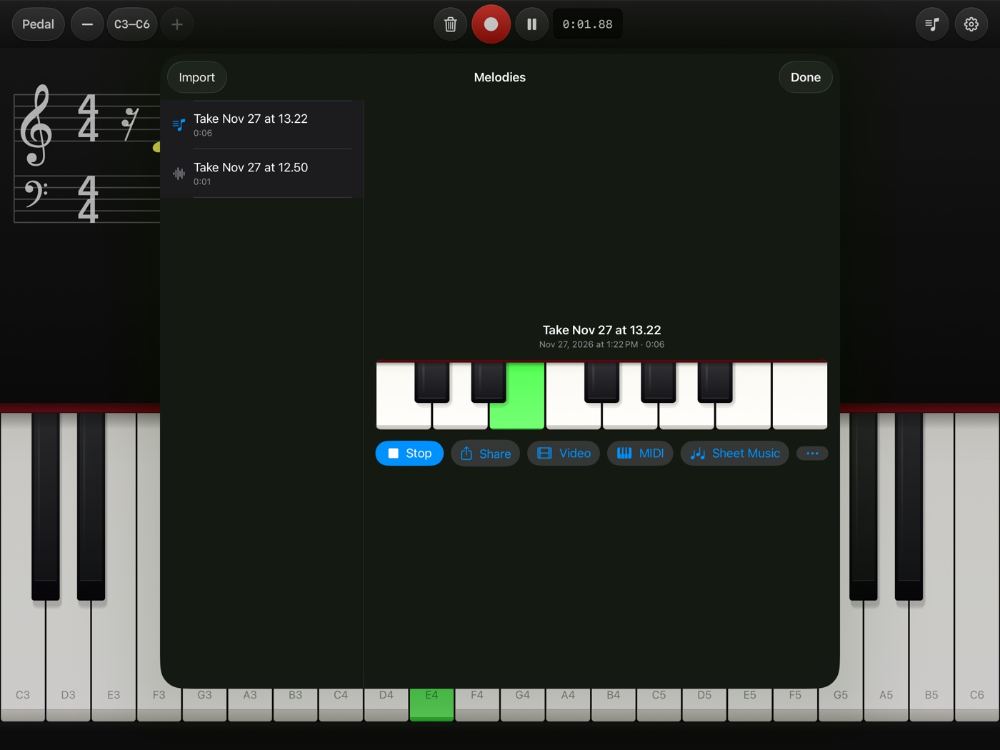
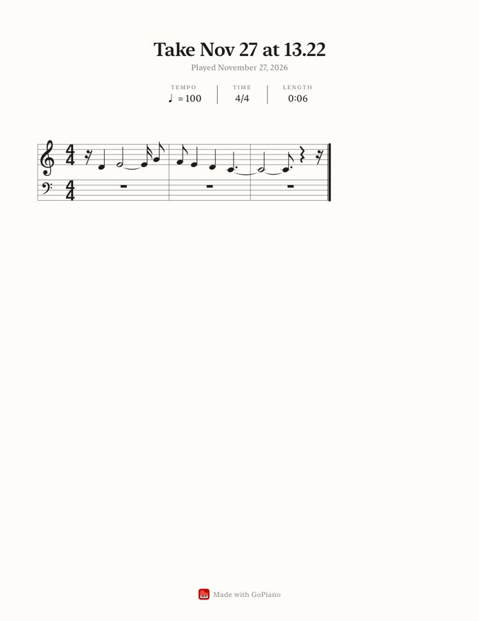

# GoPiano

A playable multi-touch piano for iPhone and iPad: hold down chords, slide between
keys, record what you play, then watch it back on the keyboard or share it as a
video with the keys lighting up. On iPad the music is written out above the keys
as you play, and any song or take can be shared as a PDF of its sheet music.

*Each note has its own colour, the same in every octave, so the notes of a chord
are easy to tell apart. Turn Note Colours off and a held key just looks pressed.*

*On iPad the sheet music sits above two or three octaves of keys. A take recorded
to the metronome is written in bars with real note values; during playback the
note being played is shaded.*

*Tap a melody and it plays on the keyboard, keys lighting up as they were pressed.
Share it as audio, or export it as video, MIDI or sheet music.*

*The shared PDF: plain ink on ivory paper, with the tempo, metre and length.*

## Building

Open `GoPiano.xcodeproj` and run. Swift Package Manager pulls
[AudioKit](https://github.com/AudioKit/AudioKit) and
[DunneAudioKit](https://github.com/AudioKit/DunneAudioKit) on first build;
no other setup is needed.

Requires Xcode 16 or newer and iOS 17.

## How it works

- **`Conductor`** owns the audio graph: a multi-sampled piano into a room reverb
  and a hall reverb that fades in only while the pedal is down, tapped by a
  recorder, plus a player for listening back and a metronome click that joins
  the mix after the tap, so it is heard but never recorded.
- **`PianoLayout`** holds the key geometry and hit testing, so the same numbers
  decide what gets drawn and what a touch lands on.
- **`KeyboardRenderer`** draws the keys - ivory and ebony, the felt strip, held
  keys in their note's colour - for the live keyboard, the library preview and
  exported video alike.
- **`KeyboardView`** puts that on a SwiftUI `Canvas` and takes touches
  from **`TouchTracker`**, a small `UIView` bridge. SwiftUI gestures only track
  one finger, which is no use for a piano.
- **`SampleMap`** is generated from `Tools/samples.csv` — see `Tools/README.md`.
- **`MIDIFile`** turns a `MelodyScore` into a Standard MIDI File, and
  **`MIDIImport`** reads one back in - see MIDI below.
- **`SheetMusic`** and **`MeteredMusic`** engrave a score with Core Graphics -
  freely played music note by note, music with a beat in bars - and
  **`ScoreView`** shows it above the keys. The PDF is drawn by the same code.

Two ordering constraints in the audio setup are load-bearing, and both are
commented at the call site in `Conductor.start()`:

1. The engine must be **started before** the samples are handed to the sampler.
   Its DSP only learns the real hardware sample rate once running, and swapping
   in sampler data re-initialises the core sampler with whatever rate it knows
   at that moment. Load first and every note plays about 1.5 semitones sharp.
2. Sampler parameters must be set **before** that swap, not after — the swap
   copies envelope settings across from the current sampler, and writes made
   straight after it are rejected.

The engine is restarted, and the instrument handed over again, whenever the
audio session is interrupted or the route changes. A call or a pulled headphone
jack stops the engine, and a new route can mean a new sample rate - which the
sampler has to be told about, or every note comes out at the wrong pitch.

Two more things worth knowing about the sampler:

- The first MIDI event costs the best part of a second in lazy setup. That is
  spent at launch with a note-off, or it lands on the first key the player
  touches - delaying the sound, and the note written into a take with it.
- Do not call `silence()`. It calls `stopAllVoices()`, which sets a flag that
  only `restartVoices()` clears, so the sampler goes quiet permanently.

Touches are tracked by a `UIGestureRecognizer` rather than a `UIView`'s own
touch methods, because raw view touches get cancelled when an ancestor
recognizer claims the sequence.

Each sample also declares its own key range. The key map matches a note against
every sample whose range contains it and takes the first hit, so leaving the
ranges wide open makes one sample answer for the whole keyboard.

## Getting around

The app opens straight onto the keyboard, and deliberately stays that way:
every screen you pass through before making a sound is a tax on an instrument.
Navigation lives in the control bar rather than a tab bar, which in landscape
would eat height the keys need.

- **Melodies** is a landscape two-column view - the library on the left, the
  selected melody on the right with a small keyboard that lights up as it plays
  and the share and export actions in plain sight. A single-column list here
  wastes the width and squeezes every row into a sliver.
- **Settings** is a popover, not a screen: a handful of switches - note names
  on the keys, note colours, names on the sheet music, touch dynamics, reverb
  and the metronome - do not justify covering the keyboard.
- The keys stop short of the bottom edge, leaving a bezel where a real keyboard
  has one. That is also what keeps the swipe out of the app from sounding a note
  on the way.

## Replay and video

Recording a take captures the notes as well as the audio: one span per note held
down, in `MelodyScore`. Tapping a melody plays it on the keyboard with the keys
lighting up, and **Share Video** renders it as an MP4 - the keyboard drawn frame
by frame from those spans, muxed with the melody's own audio.

Nothing is screen-captured, so an exported video has no status bar, no fingers
and no UI chrome. It is also framed to the notes that were actually played
rather than to whatever the octave controls happened to be set to.

`KeyboardRenderer` is the single drawing routine behind both the live keyboard
and the video, so the two cannot drift apart.

Melodies saved before this existed have no score: they still play and share as
audio, and **Video** and **MIDI** are simply unavailable for them.

## Sheet music

On iPad the space above the keys is a page of music, written as you play:
each key adds its note after the last, chords stack, and lines fill and wrap.
The trash button clears it.

- **Played freely**, there is no beat to measure rhythm against, and a guessed
  rhythm would be written wrong. The notes are written in the order they were
  played, every one the same value.
- **Recorded to the metronome**, or **imported from MIDI**, the music has a beat,
  so it is written properly: bars and a time signature, notes from whole notes to
  sixteenths, dots, rests, ties across bar lines, sharps and naturals that carry
  through the bar. Positions are snapped to the nearest sixteenth.

**Names on Sheet Music** adds each note's letter under the staff, chords stacked
highest first; a line with very low notes grows deeper so they never cover the
names. **Note Colours** draws each notehead in its key's colour.

**Sheet Music** in the library, or **Share Sheet Music** for an imported song,
writes the same engraving to a PDF - Letter or A4 by region, over as many pages
as it needs, in plain black ink so it prints cleanly.

## Metronome

With **Metronome** on in Settings, recording counts in one bar of clicks and
starts on the downbeat. Tempo runs from 40 to 220 and the metre is 2/4, 3/4 or
4/4. The take keeps its tempo and time signature, which is what lets it be
written in bars and exported to MIDI with its real tempo.

Clicks are scheduled ahead at exact host times on their own player node, so they
keep time to the sample rather than to the main thread.

## MIDI

**MIDI** writes the same spans out as a Standard MIDI File, so a melody can be
opened in a DAW and edited as notes rather than as a waveform. The file is
format 0, 480 ticks per quarter note, with each note's velocity as it was
played.

A take recorded to the metronome is written at its own tempo with its time
signature, so it lines up with a DAW's grid. One played freely has no tempo to
preserve - only the real times the keys went down. Those times are written
against a declared 120 bpm, which keeps them exact in seconds and lets a DAW lay
its own grid over an unquantised performance rather than pretending the playing
was in time.

**Import** in the library goes the other way: any Standard MIDI File is read
through AudioToolbox's `MusicSequence` - which deals with multi-track files,
running status and tempo maps - and performed on the keyboard, with its sheet
music above it on iPad.

## Saving and sharing

Saved melodies are encoded to AAC in an `.m4a` container and kept in the app's
Documents folder. They survive relaunches, show up in the Files app under
GoPiano, and go straight to the share sheet from the melody list.

The recorder itself writes uncompressed float CAF, which runs to roughly 20 MB a
minute and which plenty of apps refuse to open, so saving converts. A minute of
playing lands around 1 MB.

## Playing

How hard a note sounds comes from where the key is struck: towards the player is
louder. Real velocity needs pressure the screen cannot measure and touch area is
too noisy to play with, but position is predictable and works on every device.

How many octaves are shown depends on the screen: a phone switches between one
and two, an iPad between two and three, with the sheet music always above them.
Four fits on a 13-inch iPad but the keys end up too thin to hit. The keys keep a
real piano's proportions rather than stretching to fill the height.

The **Pedal** holds notes after the keys are let go and brings in a hall reverb;
lifting it damps them, as a real piano's dampers would. Without it, a released
note stops soon after.

The octave controls stop at the top of the sampled range. Past it there is
nothing left to play but the topmost sample stretched upwards, which sounds
thin, so the buttons simply do not go there.

VoiceOver gets a row of buttons standing in for the drawn keys, one per note.

## Sound

The piano is multi-sampled across MIDI 21-84 (A0 to C6) and pitched from the
nearest sample outside that. Tuning was calibrated against captured output;
across the sampled range the played pitch lands within a few cents of equal
temperament. `Tools/README.md` covers where the samples came from.

## Credits

Piano samples are from the [Piano FF](https://freesound.org/people/jobro/packs/2489/)
pack by **jobro** on Freesound, used under
[CC BY 3.0](https://creativecommons.org/licenses/by/3.0/). The samples have been
modified: resampled, retuned to concert pitch and remapped across the keyboard.
See `Tools/README.md` for how.

The licence requires this credit, so it also appears in the app, under Settings.
